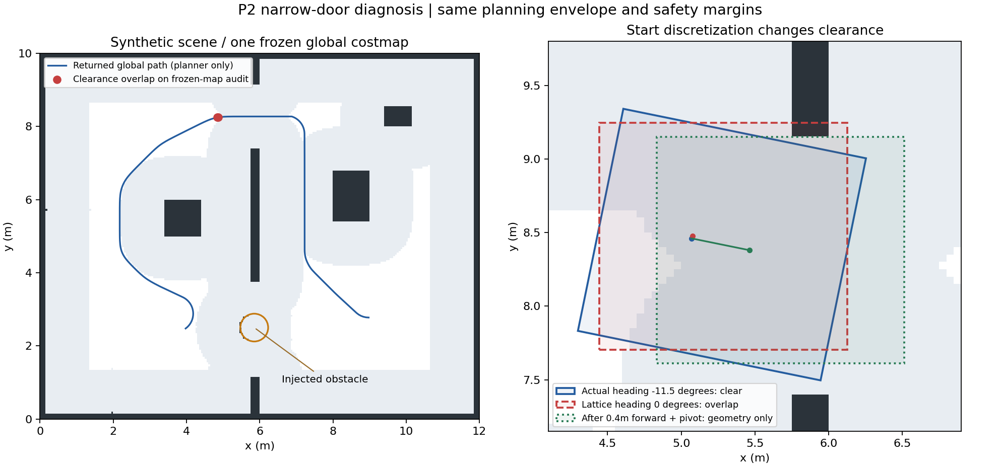

# 窄门规划诊断补充 · 2026-10-30

本组找到了一个可复现的起点量化问题：连续姿态的完整停车余量包络可行，量化为格点朝向后却碰到墙。延长搜索时间无效。另有返回路径在冻结地图复核时出现少量余量包络相交，需要继续核验平滑与地图时刻。本组是规划查询与离线几何诊断，不是行走、避障或实机验收，也没有修改 v0.4.0 的导航参数。

## 一组有界对照

使用 v0.4.0 源码 `f00cd0580c6f3e3f092abd4392ac6671c5a1bb5c`、Nav2 1.1.20、已验证的 Cyclone DDS 本机配置。场景是仓库内生成的 12 × 10 m 合成场景，给下方门口放置半径 0.38 m 的障碍，模拟器回执确认生效。固定五个起点与相同目标，分别给予 3 / 10 秒搜索预算，共十次路径查询；没有发送导航或非零速度命令。

规划仍使用当前停车区：机身原点前 1.00 m、后 0.58 m、左右各 0.72 m，另加原有 0.05 m 栅格足迹 padding。速度上限 0.15 m/s、地面和源时间门限均未放宽。

| 起点 | 3 秒 / 10 秒预算结果 | 实际规划时间 | 冻结地图完整包络复核 |
| --- | --- | --- | --- |
| (4.0, 2.5, 0) 绕行起点 | 均返回路径 | 约 0.22 s | 返回路径各有 6 个相交采样 |
| (4.2, 8.3, 0) 上门口预对齐 | 均返回路径 | 约 0.08 s | 各有 3 个相交采样 |
| (5.07, 8.46, −0.2014) 原失败位姿 | 均立即拒绝 | 毫秒级；没有有效规划耗时 | 连续姿态无致命格，离散姿态触及致命格 |
| 同一位置，朝向 0 | 均立即拒绝 | 毫秒级 | 连续与离散姿态均触及致命格 |
| (5.07, 8.3, 0) 门口居中 | 均返回路径 | 约 0.02 s | 各有 3 个相交采样 |

因此，在这个静止场景中，增加规划时间并不能修复原失败位姿。不能把这个结论直接套到全部其他无路径错误。

## 起点为何被拒绝

原位姿约为 x=5.07、y=8.46、偏航 −11.5°。用实际 Nav2 C++ 足迹检查器在同一冻结地图检查：连续姿态成本为 253，没有覆盖致命或未知格；转换到约 (5.075, 8.475, 0°) 的格点姿态后，成本为 254，包络进入上门口墙边。253 是膨胀成本，254 是致命格；这里的“可行”指完整矩形未覆盖致命/未知格，不是零代价。

Humble Lattice 源码在搜索前会将起点位置和角度转换为格点与最近航向，[对应实现](https://github.com/ros-navigation/navigation2/blob/a097086719c88f781aa59788eca29ac6ca5e56db/nav2_smac_planner/src/smac_planner_lattice.cpp#L230) 与本次现象一致。这支持起点量化碰撞这个具体解释，不能说明此前每个失败都只有这一个原因。

直接在原地转到 0° 也会使包络相交，不能把跳过起点检查或强制转身当成修复。离线构造“沿当前方向前进，再对齐 0°”的连接，0–0.30 m 候选仍相交，0.40 m 起的候选在这张冻结地图中通过了几何检查。这个连接尚未经过步态、实际估计器和控制器跟踪验证，不能据此自动执行。

## 返回路径也需要复核

对返回路径按最多 0.025 m / 0.025 rad 插值，用严格限制在实际 padded 足迹内部的采样和实际 Nav2 C++ 足迹检查器分别检查，两者得到相同的 6 / 3 / 3 个相交采样。它们是扩大后的停车余量包络，不代表真实机身已经碰撞；本组没有驱动模型行走。

初版 Python 采样曾越过 Y 边界 0.01 m，其较大计数已作废；上表使用修正后的严格边界采样，并经独立 C++ 检查确认。

重要限制：这次只保存了查询前的一张全局代价地图，没有逐请求保存地图前后快照。虽然模拟器位姿和扫描静止，仍不能据此证明规划时刻的地图完全相同，或断言相交一定由平滑引起。Humble 的 [平滑实现](https://github.com/ros-navigation/navigation2/blob/a097086719c88f781aa59788eca29ac6ca5e56db/nav2_smac_planner/src/smoother.cpp#L140) 主要检查更新位置的栅格成本，值得针对非圆形包络继续做原始路径与平滑路径对照。

下一组应同时记录未平滑路径、返回路径及每次查询前后的地图，比较原配置与关闭平滑的候选；若需要起点连接，也必须保留完整足迹检查并通过控制跟踪回归。任何导航改进仍要求目标完成、障碍确实生效和零包络侵入联合通过，不能仅凭本次几何诊断算通过。

本组未操作真实机器人、脖子或电池。隔离容器完成后停止。完整字段见 [诊断数据](planner-diagnostic-2026-10-30.json)，此前完整链路结果见 [持续仿真报告](VALIDATION_2026-10-30.md)。
