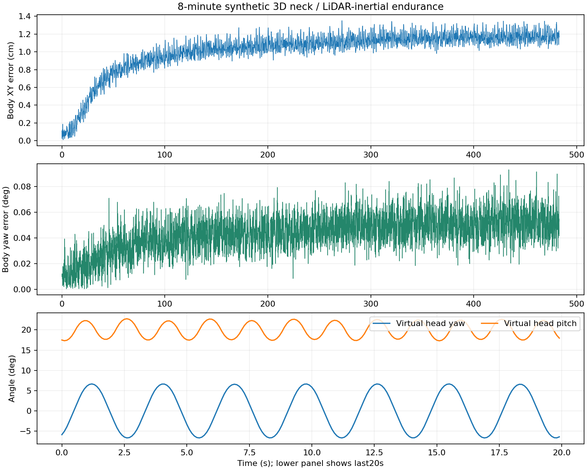

# 2026-10-30 持续仿真与迁移验证

本轮完成三维传感器参与的建图、地图保存与重新定位导航，修复低速终点绕圈、近目标重新规划退出、静止启动漏定位和栅格地图保存超时。动态障碍复测在降速、扩大停车区后通过。复杂窄通道仍有失败，所以本版本保持实验状态；这些结果不等于实机行走验收。

实验运行于隔离的 x86 容器，使用 Nav2 1.1.20、SLAM Toolbox 2.6.10 与锁定的 FAST-LIO。P2 动力学使用本机提供的模型、策略与控制器，仅在 MuJoCo 中运行。整轮没有向真实电机或脖子发送控制命令。实机电池输出在结束前另作三次只读检查，保持关闭。

## 三维闭环与验收结果

`P2 模型步态 → 带逐点时间的三维射线 / 200 Hz IMU → 实际 FAST-LIO → 按源时间插值的颈部关节链 → 机身里程计 / 障碍扫描 → SLAM Toolbox 或 AMCL → Nav2 → 平滑 / 碰撞监视 / 前向速度门 → 隔离模型`。

三维导航没有输入真值里程计。模型真值用于评估、放置合成障碍与模拟人工建图路线；地图重载使用一次已知起点的初始位姿先验，不做全轨迹拟合。三维链路的模型速度 PI 关闭，仍使用明确标注的模型响应补偿；它不是实机速度标定。

| 验证 | 结果 | 实际覆盖 |
| --- | --- | --- |
| 最终 0.15 m/s 候选三维动态障碍导航 | 2/2 目标完成、包络侵入 0 | 两次确认模型正在移动后注入障碍，四条设置/移除请求均收到模拟器确认；停车并恢复到达 |
| 三维传感器建图 | 237 × 198、5 cm 栅格；保存 YAML、PGM、data、posegraph | 人工路线模拟，约 33,253 个已知格；原始生成地图仅作私有试验记录 |
| 同一最终候选载入三维地图导航 | 2/2 目标完成、包络侵入 0 | 新 FAST-LIO 会话、AMCL 初始位姿先验；模型位置误差约 5.1 / 10.4 cm |
| 三维传感器与小障碍故障 | 5 项通过、包络侵入 0 | 关节 / 雷达 / IMU 中断归零，小障碍停车、移除后恢复；各项先确认模型实际移动 |
| 独立平面故障回归 | 8/8 通过，8 条场景控制收到确认 | 速度上限、地面缺失、扫描/里程计中断、小障碍、横移/倒退拒绝、暂停 |
| 工作台完整流程 | 通过 | 最终配置使用 Cyclone DDS 对比，完成 HTTP 建图、保存、重载、定位、0.10 / 0.15 m/s 目标、取消归零；0.20 m/s 与错误令牌拒绝 |
| 代码回归 | 87 个 Python 测试、2 个 C++ 检查程序通过 | 另有 ROS 扩展的真实编译与运行 |

故障测试检查中断后 800 ms、小障碍后 1 s 的观测窗口内指令归零，不是实物停止距离认证。场景控制必须先收到模拟器回执，避免命令在 DDS 尚未匹配时丢失却误报通过。到达目标与零碰撞必须同时满足，才能计为避障通过。

## 保留的失败与修复依据

此前较快的两轮三维动态障碍测试虽然目标到达 2/2，仍分别出现 20 / 62 个包络侵入采样，均撤销避障通过。这些计数是接触采样数，不代表独立碰撞次数。障碍在机身原点前 0.8 m 突然出现，留给包络的实际间距不足以覆盖该模型的感知与踏步停止响应。

最终 P2 候选把前向上限收紧为 0.15 m/s，停车区前端扩大到机身原点前 1.00 m，减速区前端为 1.42 m，全局规划同步预留停车空间。第一次低速复测侵入为 0，但第二个目标在已抵近时被格点规划中断，仍判失败。补上经过完整包络检查的近距离连接后，才得到上表两次障碍停车、恢复与目标完成的联合通过。这里的通过仅覆盖所测障碍出现距离、几何和速度，不能外推到任意近距离突然障碍。

两个原始静态堵门场景曾在第二个目标失败；更窄的上方门口也出现规划起点不可行。更密的 64 航向基元原型先触发上游规划错误，修正采样后，在确认障碍实际存在的复测中仍仅完成 1/2 目标，因此没有发布。更早未确认障碍控制生效的静态试验只作探索记录，不纳入本轮避障验收。

最终停车区比早期试验更大，复杂窄通道尚未获得通过，不能宣称通用室内自主导航已经成熟。数次三维启动还遇到导航栈未进入 Active：检查阻止了起步，后续隔离传输与延后启动查询的重试完成，定位与导航生命周期管理器分阶段启动后，三维地图重载完成，但另一次工作台启动仍丢失服务响应；这不能算彻底修复。随后对比 Cyclone DDS（rmw 1.3.5 / DDS 0.10.5），完成同样工作台和三维地图重载导航，侵入为 0。源码保留标准 ROS 2 中间件选择，可按文档选择该已测仿真选项；这里仍只覆盖少量启动，尚未验证真实传感器部署与长期稳定。症状与 [rmw_fastrtps 服务响应竞争问题](https://github.com/ros2/rmw_fastrtps/issues/842) 相近，这是排查线索，尚不能认定已证明全部根因或长期稳定性。

## 8 分钟虚拟颈部运动

初始化后评估约 483 s、4,832 个样本，机身保持静止：位置误差 p95 约 1.25 cm、最大 1.35 cm；航向误差 p95 约 0.065°、最大 0.093°。里程计源时间年龄 p99 约 0.203 s、最大 0.331 s，全部在 0.5 s 门限内。没有源队列丢弃或协议错误，硬件标定就绪始终为假。评估只用起始 2 s 确定一个固定平面坐标对齐。

虚拟颈部实际范围为俯仰约 16–24°、偏航约 ±6.7°，采用模型关节定义，不是实机编码器推荐值。现有模型头部质量已并入躯干；本轮只验证运动头部的几何与时序，没有验证它对平衡的惯量耦合。模拟器每帧使用 2,400 条子采样射线，未覆盖完整光学扫描、反射和自遮挡，x86 计算时间不能直接套到 RK3588 或完整 MID-360S 点云。

## 控制与迁移

`--gait-profile p2-flat-model` 显式选择当前候选。横移与倒退仍拒绝，候选角速度上限 0.24 rad/s，最终角加速度仍为 0.5 rad/s²；扫描/里程计 0.5 s 过期和命令 0.3 s 超时保留。转向前等平移收稳，前进前等角速度收稳。遇障碍立即归零，通路连续有效 0.75 s 后才允许恢复。

近目标 0.30 m 内先获取位置、再对齐朝向。规划短连接按最多 0.02 m / 0.02 rad 采样检查完整规划包络，检查失败继续使用格点规划；成功容差仍为 0.15 m / 0.15 rad。程序没有通过放宽这些门限提高通过率。实现与安装见 [双足适配](BIPED.md)。

换到 P2-1003 / 1005 时可复用源码，在目标架构重新构建依赖和可选 ROS 扩展，并重新生成该机的序列号与安装 ID。地图、录包、对齐和外参分别保存，拒绝错机器配置或旧安装外参。仿真运行目录与实体安装分开。命令见 [迁移说明](MIGRATION.md)。

白天应先验证静止、有地面标记的小圈、保存地图重载与初始定位，再核验安装外参、颈部零位、步态速度响应和停止距离。机身 IMU 仍独立记录：设备时间与外参尚未验收，未直接融合。真实行走属于下一阶段。

可机器读取的结果见 [本轮摘要](validation-2026-10-30.json)。历史结果见 [历史验证](VALIDATION.md)。公开仓库不包含厂商策略、模型、办公室地图、录包或凭据。
